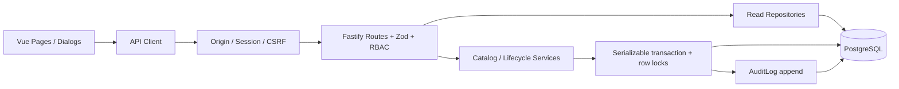

# 系統架構

AssetFlow 是模組化單體。前端與 API 分開開發，正式編譯結果可由一個 Fastify 程序同源提供；PostgreSQL 是業務資料與 Session 的唯一持久化來源。

## 目錄與入口

| 位置                                       | 職責                                                            |
| ------------------------------------------ | --------------------------------------------------------------- |
| `apps/api/src/server.ts`                   | 程序啟動、靜態資源、graceful shutdown                           |
| `apps/api/src/app.ts`                      | 可供測試注入的 Fastify factory、plugin、健康檢查、OpenAPI       |
| `apps/api/src/config.ts`                   | 驗證環境變數，從 repository root 讀取本機 `.env`                |
| `apps/api/src/auth.ts`                     | Cookie hash 查詢、有效 Session、Origin／CSRF、防護與權限 helper |
| `apps/api/src/routes.ts`                   | HTTP 邊界、驗證、授權、status code、OpenAPI metadata            |
| `apps/api/src/schemas.ts`                  | Zod request schemas、日期與列表限制                             |
| `apps/api/src/services/catalog.ts`         | 資產／員工變更、使用者與最後管理員保護                          |
| `apps/api/src/services/lifecycle.ts`       | 領還、維修、除役、交接狀態轉換                                  |
| `apps/api/src/repositories/catalog.ts`     | 組合搜尋、列表、詳情選取、Dashboard 快照                        |
| `apps/api/src/db.ts`                       | Prisma Pg adapter、交易重試、參數化鎖與稽核 helper              |
| `apps/api/prisma/`                         | Schema、3 份 Migration、可重複 Seed                             |
| `apps/web/src/main.ts`                     | Vue、Pinia、Router 組裝                                         |
| `apps/web/src/router.ts`                   | 登入與管理員頁面守衛、Session 到期導向                          |
| `apps/web/src/stores/auth.ts`              | 使用者、登入狀態與權限衍生值                                    |
| `apps/web/src/api/client.ts`               | 同源 fetch、CSRF、統一 API 錯誤與到期事件                       |
| `apps/web/src/composables/`                | 可取消讀取、分頁／篩選、表單定義與 payload 轉換                 |
| `apps/web/src/components/`                 | Shell、原生 Dialog、遠端搜尋選項、Loading／Empty／Error、分頁   |
| `apps/web/src/pages/`                      | 11 個產品頁面與 404                                             |
| `packages/shared/src/index.ts`             | 角色、狀態標籤、Asia/Taipei 日期工具與少量跨層契約              |
| `apps/api/test/`、`apps/web/test/`、`e2e/` | 真實 DB、元件與瀏覽器測試                                       |

Repository 根目錄直接就是 npm workspace，不另外加一層同名資料夾。共用套件只承載穩定的小型契約，不把 Prisma client 或資料庫欄位整包送入瀏覽器。

## 前端資料流與狀態

Pinia 僅保存登入使用者與已還原狀態。CSRF token 保存在 API client 記憶體；頁面刷新從 `/auth/session` 重建，沒有 localStorage 業務資料。

`useCollection` 保存分頁與篩選，輸入 debounce 200ms，使用 AbortController 取消舊請求並防止過期回應覆蓋新結果。列表每頁 20 筆，伺服器上限 100。詳情使用 `useResource` 監看路由 ID，切換資源時重新讀取。

所有變更表單都等待 API 成功；成功後重新讀取資料庫。API 拒絕時保留 Dialog、輸入與錯誤。Dialog 使用原生 `showModal()` 的焦點限制、Escape 取消、關閉後焦點還原；儲存中避免重複送出。

## 後端資料流

`onRequest` 先驗證 Origin（所有 unsafe method），查詢 token hash 與目前使用者角色，驗證到期與啟用狀態，再檢查 CSRF。Route 執行後端 RBAC 與 Zod 驗證；service 在一個 Serializable transaction 內讀鎖、檢查業務規則、變更實體、追加 Audit Log。

讀取 repository 使用 Prisma 的參數化條件。排序欄位採 allowlist，不拼接使用者提供的 SQL。資料庫外鍵／唯一性衝突映射 400／409，商業狀態衝突為 409；未知錯誤僅回傳通用訊息與 requestId。

## 執行模式

- 開發：Vite 5173 代理至 Fastify 3001；請從 `localhost:5173` 使用。
- 編譯展示：Fastify 提供 `web/dist` 與 SPA fallback；靜態資源位於 `/_static/`，避免與業務 `/assets/:id` 衝突；未知 API／缺少靜態檔保持 JSON 404。
- Compose：app + PostgreSQL 18，僅 loopback HTTP 端口；Migration 後通過健康檢查才算 app ready。
- CI：Linux 乾淨安裝與真實 PostgreSQL，另建 Docker image 並執行 Compose smoke。

沒有 Redis、微服務、訊息佇列或分散式鎖。單一 PostgreSQL 的交易與鎖已能正確處理預期數十至數百設備的規模。

HTTP `preSerialization` 僅將六個 DATE 欄位的 Prisma Date carrier（包括巢狀物件）轉為純日期；Timestamp 保留 ISO UTC、Decimal 保留字串、既有 Audit JSON 保留原樣。前端與後端同用 `packages/shared/src/dates.ts`，業務日期不依賴主機時區。
