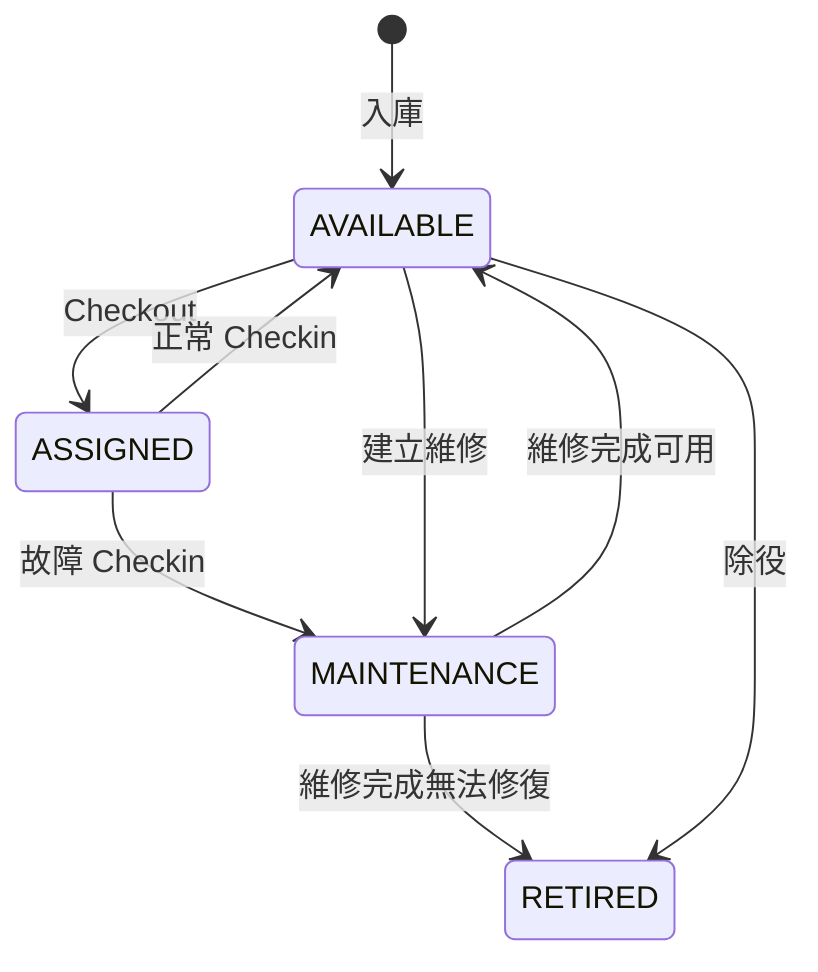

# 業務規則

## 資產狀態機

RETIRED 為終止狀態。一般資產編輯 API 不接受 status；禁止以「編輯基本資料」繞過流程。

## 領用

只有 ADMIN／IT_STAFF 可以領用。設備必須 AVAILABLE，員工必須 ACTIVE；OFFBOARDING 與 INACTIVE 都不能新增領用。預計歸還日不可早於當天（以 Asia/Taipei 業務日期作比較；當日到期不算逾期）。

使用 Employee → Asset 的固定鎖定順序，條件更新 `WHERE status=AVAILABLE`。設備狀態 ASSIGNED、有效 assignment、CHECKOUT audit 原子提交。部分唯一索引即使繞過 service，也會阻擋第二筆有效領用。

兩個或更多 IT 同時操作時最多一筆成功；其他請求 409，不留下重複有效領用。沒有在前端做 optimistic success。

## 歸還

必須指定尚未歸還的 assignment，記錄伺服器時間、操作人、狀況與選填備註。GOOD 恢復 AVAILABLE；DAMAGED 必須有故障描述，同時轉為 MAINTENANCE 並建立未結案維修。重複歸還或紀錄／狀態不一致一律 409。

歸還不刪除原領用；補上返回欄位並另寫 CHECKIN audit。交接中的員工也可以歸還。

## 維修與除役

只能把 AVAILABLE 設備直接送修。ASSIGNED 設備必須先以故障歸還。未結案維修可以更新 progress 與 notes；結案必須選擇 AVAILABLE 或 RETIRED，保存實際完成時間。結案後不可再改進度或再次結案。

可用設備可以填寫原因後直接除役；維修中設備透過維修結案除役。ASSIGNED 設備不可除役。除役保留基本資料、領用、維修及稽核歷史。

## 員工離職交接

員工資料與登入 User 沒有一對一要求，Employee 停用不等於登入帳號停用。

啟動交接必須是 ACTIVE 員工；plannedLeaveAt 不可早於 joinedAt。系統鎖住 Employee、改為 OFFBOARDING，建立交接與 audit。從此禁止新增領用。

交接清單透過 employee 的有效 assignment 即時關聯，不另存容易過期的設備快照。管理員逐項歸還後，重新讀取清單與筆數。

完成交接時，**同一交易內重新查詢 `returnedAt IS NULL` 的筆數**。只要大於 0 即 409；全部歸還且明確確認實際離職日後，保存完成時間、completedBy，將 Employee 更新為 INACTIVE、leftAt 設為本次明確輸入的實際離職日，追加 audit。

三種日期分開保存：`Offboarding.plannedLeaveAt` 是規劃的 DATE，`Employee.leftAt` 是確認的實際離職 DATE，`Offboarding.completedAt` 是本次設備交接結案的 UTC timestamp。實際離職日必填，必須介於到職日與 Asia/Taipei 今天之間，可以早於或晚於預計離職日，也可以早於交接結案當日；不得以預計日自動代填。

延續既有單一步驟結案流程：ACTIVE 表示一般在職且可領用；OFFBOARDING 表示交接處理中、禁止新增領用、尚未完成實際離職確認，不據預計日或系統時間自動切換；INACTIVE 表示已確認實際離職且設備交接已完成。提早收齊設備但員工尚未離職時，保留 OFFBOARDING，等實際離職後再結案。此版本不新增獨立 HR 離職登錄或排程狀態機。

員工基本資料編輯不能使到職日晚於既有實際離職日或未結案交接的預計離職日。結案仍在 Employee 鎖內重新檢查員工狀態、到職日與有效設備筆數；失敗時不留下 leftAt／INACTIVE／completedAt 的部分結果。

舊版已結案紀錄可能曾由預計日填入 leftAt；無法從現有三個欄位還原真實離職日，因此不猜測、不批次覆寫既有歷史。若要修正，須先取得原始人事紀錄與個別核對授權；既有 Audit Log 保留。

Checkout 與交接共用 Employee row lock。若 Checkout 先贏，交接會看到該有效領用；若啟動交接先贏，Checkout 重新驗證後拒絕。完成與歸還同時發生時，可先收到 409，歸還成功後安全重試。不得僅相信前端的「0 項」或按鈕禁用。

## 權限與稽核

VIEWER 只能查看工作空間內資料。ADMIN／IT_STAFF 可管理業務流程，只有 ADMIN 可管理 User。最後一位 active ADMIN 不能被停用或降級；變更 User role／active 撤銷該帳號的所有 Session。

每次成功的核心業務操作都在同一交易寫 audit，保存 actor、action、target、變更與 SUCCESS。失敗的業務操作不提交成功事件；401／403／409 透過 HTTP 錯誤與 requestId 呈現。尚未建立獨立的失敗登入／拒絕事件持久化表，不能把成功 Audit Log 當完整安全 SIEM。

## 衝突回應與重試

400：欄位／日期／關聯不正確；401：未登入或 Session 到期；403：角色、Origin 或 CSRF 不符；404：資源不存在；409：唯一性或狀態衝突、重複操作、未歸還交接、交易重試耗盡；429：速率限制。

沒有通用 idempotency key。領還、維修結案、交接結案均以來源狀態驗證防止重複成功；POST 建立後網路中斷時，使用者應先重新查詢再重送。這是第一版明確限制。

## 日期與時區契約

業務時區集中定義於 `@assetflow/shared` 的 `BUSINESS_TIME_ZONE = "Asia/Taipei"`，前後端使用相同定義，與 OS、瀏覽器或 PostgreSQL 預設時區無關。此版不加入可由使用者切換時區的功能。

- Date-only：購買、保固、到職、實際離職、預計歸還、預計離職。API 使用真實曆日 `YYYY-MM-DD`，資料庫維持 PostgreSQL DATE；Prisma 的 UTC 午夜 Date 僅為傳輸 carrier，不能當事件時間套用本地時區。
- Timestamp：領用、實際歸還、維修起迄、交接起迄、建立／更新、稽核、Session 到期。API 使用含 `Z` 的 ISO UTC，畫面以 Asia/Taipei 顯示。Session 依瞬間比較，不依曆日判斷。
- Dashboard 以請求開始時的業務日期為基準，僅 `expectedReturnAt < 今天` 且尚未歸還才算逾期；當日到期及已歸還均不計。
- 前端日期輸入預填／上下界使用業務日期；Timestamp 日期顯示依台灣日期，DATE 顯示保留原曆日。日期輸入不得截取 Timestamp 當日期。
