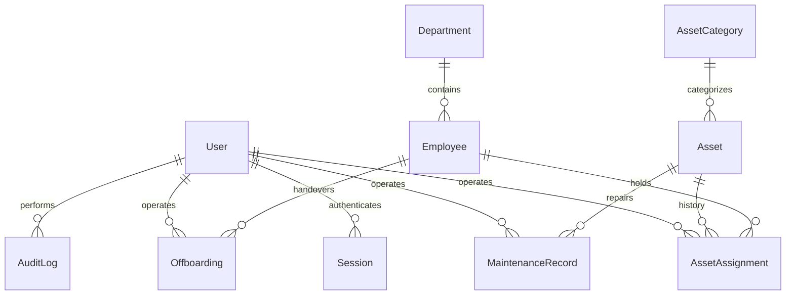

# 資料庫設計

來源為 `apps/api/prisma/schema.prisma` 與三份 checked-in SQL Migration；不可只讀 Prisma Schema 而忽略部分索引與 trigger。

## 核心實體

| 實體                       | 主要內容／約束                                                       |
| -------------------------- | -------------------------------------------------------------------- |
| User                       | email unique、Argon2id hash、角色、active；不是 Employee             |
| Session                    | tokenHash unique、CSRF token、expiresAt、userId；User 刪除才 cascade |
| Department / AssetCategory | 唯一名稱；關聯使用 Restrict                                          |
| Employee                   | 員工編號與 email unique、部門、在職狀態、到離職日期                  |
| Asset                      | 資產編號 unique、選填序號 unique、分類、保固、位置、狀態             |
| AssetAssignment            | 完整領用、預計歸還、實際歸還、兩位操作人、狀況與備註                 |
| MaintenanceRecord          | 故障描述、進度、起迄時間、結果與操作人                               |
| Offboarding                | 員工、預計離職日、啟動／完成時間與操作人                             |
| AuditLog                   | 對象類型／ID、actor、action、JSON 變更、結果、時間                   |

ID 使用 UUID 字串。業務日期為 PostgreSQL DATE，事件時間沿用既有 Prisma DateTime／PostgreSQL TIMESTAMP(3)。DATE 不代表時間瞬間，Prisma 的 Date carrier 明確以 UTC 午夜轉換，API 邊界將 DATE 轉成 `YYYY-MM-DD`，不以瀏覽器或資料庫時區轉換日期。事件欄位以 UTC wall-clock 儲存及含 Z 的 ISO timestamp 傳輸，PrismaPg 連線明確設定 `TimeZone=UTC`，使 `now()` 預設值與應用程式寫入一致。直接 SQL／ETL 也必須使用 UTC session；不得將既有 TIMESTAMP 任意當台灣時間重解讀。業務日另由共用 Asia/Taipei 函式推算。輸入日期使用 ISO `YYYY-MM-DD`，驗證真實曆日（不接受年份 0000）。金額使用 Decimal(12,2)，API 回傳字串，避免將持久化金額表示為浮點數。前端僅在輸入與顯示時轉換。

## 唯一性與索引

- `Asset.assetTag` 唯一；API trim 後轉大寫。序號空白轉 NULL，有值 trim 後轉大寫，再由唯一約束防止重複。多個 NULL 可存在。
- Employee 編號大寫，Email 小寫；User Email 小寫。
- `AssetAssignment(assetId) WHERE returnedAt IS NULL`：同一設備最多一筆有效領用。
- `MaintenanceRecord(assetId) WHERE completedAt IS NULL`：最多一筆未結案維修。
- `Offboarding(employeeId) WHERE completedAt IS NULL`：最多一筆有效交接。
- 資產狀態＋分類、員工部門＋狀態、員工有效領用、預計歸還、稽核對象＋時間均有索引。
- `%keyword%` 搜尋使用 PostgreSQL ILIKE；第一版沒有 trigram／全文索引，適合目前數百筆規模。

資料庫 unique 為儲存值精確比對；大小寫正規化是 API／Seed 寫入契約。若日後加入直接 ETL，該入口也必須遵守此契約，或另加 expression unique index。

## 完整性與歷史

FK 刪除規則以 Restrict 保護歷史，只有 Session 隨 User cascade；應用程式沒有刪除 User／Asset／Employee 的路由。

CHECK 保護非負金額、保固日期、到離職日期，以及歸還／維修／交接的完整結案欄位。第三份 Migration 明確加入 `IS NOT NULL`，避免 PostgreSQL CHECK 對 UNKNOWN 的接受行為讓半完成紀錄通過。

`AuditLog` 的 BEFORE UPDATE OR DELETE trigger 一律拒絕變更。沒有修改／刪除稽核 API。這不是防資料庫 owner 竄改的密碼學日誌；owner 仍能停用 trigger 或 TRUNCATE，正式環境需限制 runtime role 的 DDL／TRUNCATE 權限並有外部備份。

## 交易與並行

所有業務寫入經 `transaction()` 執行 Serializable transaction；辨識 Prisma `P2034`、原生 adapter 及 `P2010.meta.driverAdapterError` 包裝的 SQLSTATE `40001`／`40P01`。最多重試 4 次，採短暫指數退避；耗盡後 409。

| 操作                 | 鎖與一致性                                                                                                         |
| -------------------- | ------------------------------------------------------------------------------------------------------------------ |
| Checkout             | Employee FOR UPDATE → Asset FOR UPDATE → 驗證 ACTIVE／AVAILABLE → 條件更新狀態 → assignment → audit                |
| Checkin              | 相同 Employee → Asset 順序；重新查詢 assignment、拒絕重複，關閉 assignment、更新狀態、必要時建立維修、audit        |
| Maintenance／Retire  | 鎖 Asset；驗證可接受來源狀態，更新紀錄及狀態並 audit                                                               |
| Start Offboarding    | 鎖 Employee，標記 OFFBOARDING 並建立交接及 audit                                                                   |
| Complete Offboarding | 鎖 Employee，在同一交易重新計算有效領用，0 筆且實際離職日期有效、來源為 OFFBOARDING 才更新交接、leftAt 與 INACTIVE |
| User role update     | transaction advisory lock 序列化管理員異動，保留至少一位 active ADMIN，同時撤銷目標 Session                        |

稽核寫入失敗會整筆 rollback。實際測試以 PostgreSQL trigger 注入寫入失敗，驗證狀態、assignment 與 audit 都沒有部分結果。

Dashboard 使用 RepeatableRead 交易取得一致快照。一般分頁查詢採交易內列表＋筆數，未提供跨 HTTP 請求的快照分頁；同時新增資料時頁碼內容可變動。

## Migration 與 Seed

1. `202610210001_initial`：資料表、enum、FK、一般索引。
2. `202610210002_invariants`：部分唯一索引、CHECK、append-only trigger。
3. `202610210003_explicit_completion_checks`：補強 nullable 完成欄位。

`prisma migrate deploy` 保留既有資料。Seed 使用 unique key upsert、既有資料不變；新的領還與維修歷史透過真正 lifecycle service 建立，並非前端 fixture。

## 第一輪修正與既有資料

沿用 `plannedLeaveAt`（預計 DATE）、`Employee.leftAt`（實際 DATE）、`completedAt`（交接完成 timestamp），沒有新增欄位或改變型別，因此不需要新 Migration。三份既有 Migration 原樣保留，沒有 reset、改寫 Migration 或重設開發資料。新的規則由交易內 service 驗證，既有日期 CHECK、部分唯一索引及稽核 trigger 保留。

舊資料中的 leftAt 可能來自舊版 plannedLeaveAt，不能安全自動推定真實日期；不做猜測性 backfill。UTC timestamp 儲存契約不變，也不批次重寫歷史時間。
