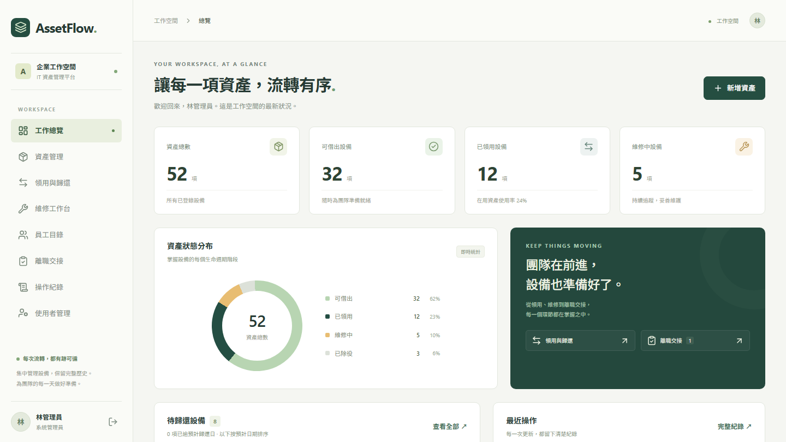
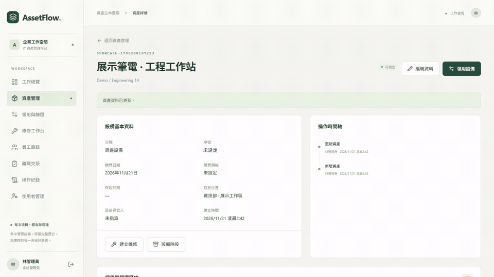
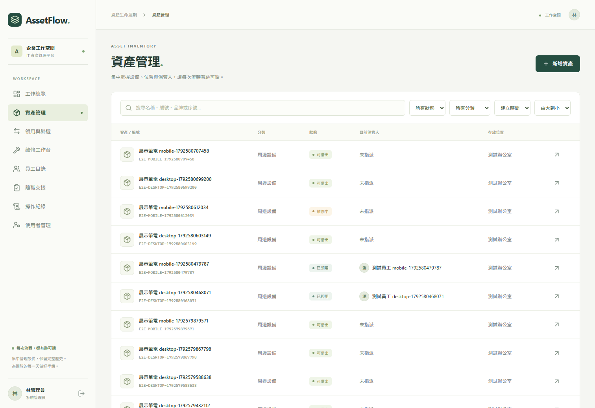
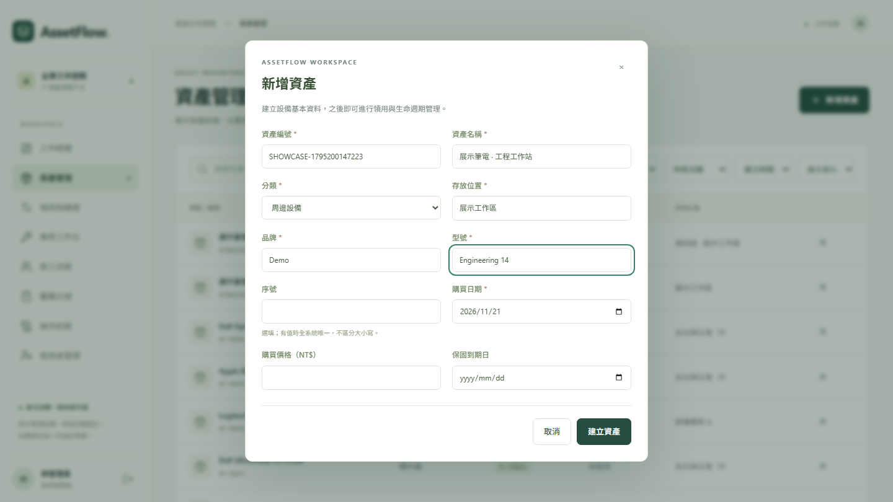
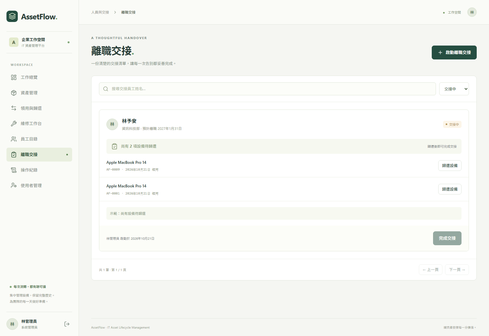
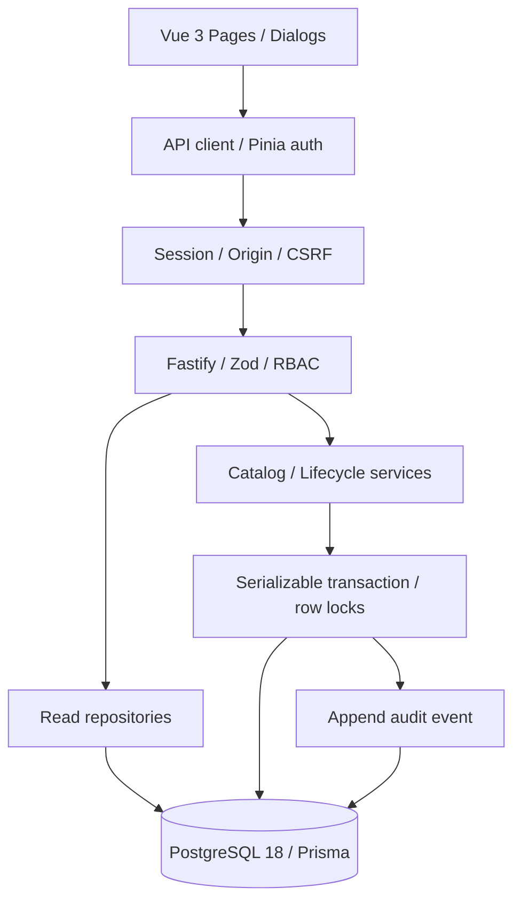

# AssetFlow ITAM

AssetFlow 是給企業 IT 團隊使用的設備管理系統。從建立資產清冊、領用、歸還到維修與離職交接，管理者可以在同一處查到設備目前由誰保管、下一步該做什麼，以及誰在何時變更了紀錄。



_本機隔離環境的真實畫面，使用合成員工與設備資料；沒有正式部署。_

## 操作展示



[觀看完整操作影片（MP4）](docs/media/demo.mp4) · [展示素材與驗證紀錄](docs/SHOWCASE.md)

影片從 Dashboard 開始，展示資產搜尋、建立與編輯、領用、歸還及稽核紀錄。媒體直接存放於 Repository，可下載播放；尚未另行發布至影音平台。

## 解決的問題

設備清冊只能回答「有哪些設備」，難以追查「誰正在用、是否能再借、離職時是否收齊」。AssetFlow 將資產、員工、領還、維修和交接放進同一個流程，每次狀態變更保留操作人與歷史，避免清冊與實際保管狀況分開維護。

### 資產清冊：用搜尋與狀態篩選找到設備



IT 人員可依名稱、編號、品牌或序號搜尋，搭配分類、狀態、排序及分頁，查找可領用或待處理設備。

### 資產表單：建立與編輯設備基本資料



表單使用共用欄位定義與原生 Dialog；API 再以 Zod 驗證，重複編號、無效日期與業務衝突會回傳明確錯誤。

### 離職交接：收齊設備後才能結案



交接清單列出未歸還資產；完成歸還並確認實際離職日期後，才可結案並停用員工。預計離職日與交接完成時間分開保存。

[手機版工作總覽](docs/screenshots/dashboard-mobile.png) 另外展示窄螢幕的導覽、統計卡片及清單排列。手機驗證使用 Chromium 裝置模擬。

## 主要功能

- **資產與員工清冊** — 搜尋、篩選與分頁，從詳情追查歷史紀錄。
- **設備領還** — 登記領用人與預計歸還日，故障歸還時同步建立維修單。
- **維修與除役** — 更新維修進度，修復後恢復可領用，無法修復時保留除役紀錄。
- **離職交接** — 自動列出待歸還設備，完成歸還並確認實際離職日後才能結案。
- **角色與稽核** — 由後端依 ADMIN、IT_STAFF、VIEWER 控管操作權限，並保留資產與人員的變更事件。

## 技術與架構

| 層級       | 技術                                                               |
| ---------- | ------------------------------------------------------------------ |
| 前端       | Vue 3、TypeScript、Vite、Pinia、Vue Router、Tailwind CSS           |
| API        | Fastify、Zod、Argon2id、伺服器端 Session 與 CSRF                   |
| 資料       | PostgreSQL 18、Prisma、SQL 約束與 Trigger                          |
| 驗證與交付 | Vitest、Vue Test Utils、Playwright、Docker Compose、GitHub Actions |



前端負責表單與操作回饋，API 驗證 Session 和角色，生命週期服務在交易內更新狀態並寫入稽核事件。 [架構與資料流](ARCHITECTURE.md) · [ERD 與資料庫約束](DATABASE_DESIGN.md)

## 工程重點

- **防止重複領用。** 資產與員工的列鎖、Serializable 交易與有效領用的唯一約束一起守住資料一致性。同一設備的 8 個並行領用請求，整合測試只允許 1 個成功。
- **維持操作與稽核一致。** 狀態、業務紀錄與 Audit Log 同交易提交。測試刻意讓稽核寫入失敗，確認設備狀態與領用紀錄一併回滾。資料庫 Trigger 阻止更新或刪除稽核事件。
- **分開處理業務日期與事件時間。** 到期和實際離職以 Asia/Taipei 的日曆日判定，事件時間保留時間點。交接結案把設備檢查、實際離職日與員工停用放在同一交易。 [日期與交接審查紀錄](docs/ENGINEERING_REVIEW_1.md)

## 技術決策

- **模組化單體。** npm workspaces 分開 web、api 與 shared，維持單一 PostgreSQL 交易邊界；編譯後可由 Fastify 同源提供前端。
- **Vue 狀態留在需要的地方。** Pinia 保存登入狀態，頁面以 `useCollection`、`useResource` 讀取資料；搜尋具備 debounce、取消請求與過期回應保護。
- **共用元件處理重複流程。** `FormDialog`、`SearchSelect`、`AsyncState` 與 `Pagination` 統一表單、遠端選項、載入／錯誤及分頁；原生 Dialog 保留鍵盤與焦點行為。
- **Session 可即時撤銷。** HttpOnly Cookie 保存隨機 token，資料庫僅保存其 hash；每次請求重新檢查帳號狀態與角色。

[現有 ADR 與取捨](DECISIONS.md) · [安全邊界](SECURITY.md) · [核對架構的原始碼入口](ARCHITECTURE.md)

## 測試與成果

| 驗證                 | 有依據的結果與範圍                                                                                                                          |
| -------------------- | ------------------------------------------------------------------------------------------------------------------------------------------- |
| 單元與 Vue 元件      | 2026-11-21 重跑 26 項通過，涵蓋表單、權限、資料載入與台灣業務日期                                                                           |
| 真實 PostgreSQL 整合 | 2026-11-21 重跑 43 項通過，包含 8 個並行領用只成功 1 筆、交易回滾、權限及交接邊界                                                           |
| Chromium E2E         | 2026-11-21 compiled 6 項通過，包含桌面與 Pixel 7 模擬；dev 模式的結果保留於歷史紀錄                                                         |
| CI 基準              | [`7a698fb` 的 quality 與 Docker jobs 通過](https://github.com/Cizing24/assetflow-itam/actions/runs/39593727102)；這是對應程式版本的歷史證據 |
| 本次展示驗證         | 真實 API 操作、媒體規格與文件連結檢查，實際結果見 [本次紀錄](docs/SHOWCASE.md)                                                              |

上述數字是指定日期與 commit 的測試結果，沒有換算成正式環境效能或商業成效。[完整案例、失敗修復及重現指令](TESTING.md)。

2026-11-21 重新安裝既有 lockfile 後，`npm audit` 回報 15 項弱點（12 moderate、3 high）。這與歷史稽核結果不同，需另行評估受影響的工具及 runtime 依賴；本次展示文件更新未升級套件。

## 快速啟動

**Docker 展示（PowerShell）。** 需要 Git、Docker Engine 或 Docker Desktop，以及 Compose v2。在新終端執行，先將下方兩個密碼範例換成自己的本機展示值。資料庫密碼請使用英數字，以符合 Compose 中的連線 URL。

```powershell
git clone https://github.com/Cizing24/assetflow-itam.git
cd assetflow-itam
$env:POSTGRES_PASSWORD = 'ChooseLocalDatabasePassword'
$env:APP_ORIGIN = 'http://localhost:3001'
$env:DEMO_SEED = 'true'
$env:DEMO_PASSWORD = 'ChooseLocalDemoPassword'
docker compose up --build -d --wait
docker compose exec app npm run db:seed
```

開啟 [http://localhost:3001](http://localhost:3001)，以 `admin@assetflow.local` 登入，密碼是上面設定的 `DEMO_PASSWORD`（至少 12 字元）。也可用 `it@assetflow.local` 操作領還與交接，或用 `viewer@assetflow.local` 查看唯讀介面。

Compose 啟動時會套用 Migration，僅對主機的 loopback 開放 app。使用 `docker compose down` 停止並保留展示資料。Seed 與這組 Compose 設定僅供本機使用。 [安全與部署設定](SECURITY.md)

<details>
<summary>Windows 原生開發方式</summary>

需要 Node.js 22 LTS（至少 22.12）、npm 與 PostgreSQL 18。若 PostgreSQL 安裝在非預設位置，先設定 `$env:PG_BIN` 指向其 `bin` 資料夾。執行 `Copy-Item` 後，請先在 `.env` 設定自己的本機 `DEMO_PASSWORD`，再繼續。

```powershell
Copy-Item .env.example .env
npm.cmd ci
npm.cmd run db:local
npm.cmd run db:generate
npm.cmd run build -w @assetflow/shared
npm.cmd run db:migrate
npm.cmd run db:seed
npm.cmd run dev
```

前端開在 [http://localhost:5173](http://localhost:5173)，Vite 代理 API。 `db:local` 使用專案內的獨立資料目錄與 `127.0.0.1:55432`。停止開發伺服器後，可用 `powershell -NoProfile -ExecutionPolicy Bypass -File scripts/local-db.ps1 -Stop` 停止專案資料庫。

</details>

## 測試與技術文件

- [測試紀錄](TESTING.md) 收錄 Vue 元件、真實 PostgreSQL 整合與桌面／手機 Chromium E2E，包含並行領用、稽核回滾和交接日期案例。 [提交 `7a698fb` 的 CI](https://github.com/Cizing24/assetflow-itam/actions/runs/39593727102)
- 在本機執行 `npm test` 可跑單元與元件測試。執行 `npm run test:api` 前，先為 `TEST_DATABASE_URL` 指定名稱以 `_test` 結尾的專用 PostgreSQL 資料庫，並以該連線套用 Migration。API 測試會清空測試庫的業務表。
- 執行 `npm run lint`、`npm run typecheck`、`npm run build` 檢查程式品質與編譯。既有 API fixture 的 Origin 固定為 `http://localhost:5173`；若自行調整展示埠，執行整合測試時需將 `APP_ORIGIN` 設回此值。瀏覽器測試可透過 `E2E_BASE_URL` 指定展示網址，完整指令見 [TESTING.md](TESTING.md)。
- [業務規則](BUSINESS_RULES.md) · [API 契約](API.md) · [OpenAPI](docs/openapi.json) · [技術選型](DECISIONS.md)

## 目前範圍

單一企業工作空間，VIEWER 的唯讀權限涵蓋整個空間。專案提供本機展示，沒有公開登入或正式部署。資產與員工歷史透過除役、交接及停用保留。

已實作的領還與維修會寫入真實 PostgreSQL；媒體中的員工、設備與操作紀錄都是合成展示資料。未實作多租戶、SSO、郵件、忘記密碼、檔案上傳或 QR Code；未驗證實體手機、Safari／Firefox、長時間負載及完整無障礙稽核。

<details>
<summary>既有展示協作紀錄</summary>

Tanci 指定求職展示目標、希望凸顯的工程重點與公開範圍。Codex 協助核對 Vue 與 API 流程、交易規則、截圖和測試紀錄，整理作品集案例及本頁。這段分工涵蓋有紀錄的展示工作。[公開協作紀錄](https://github.com/Cizing24/developer-portfolio/blob/main/docs/AI_COLLABORATION.md)

</details>
