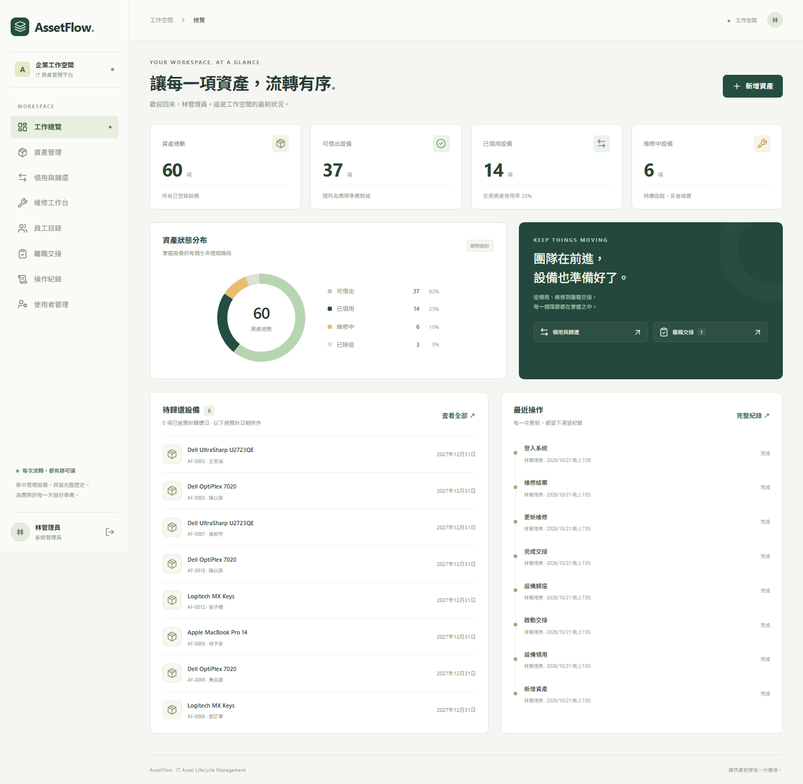

# AssetFlow ITAM

AssetFlow 是給企業 IT 團隊使用的設備管理系統。從建立資產清冊、領用、歸還到維修與離職交接，管理者可以在同一處查到設備目前由誰保管、下一步該做什麼，以及誰在何時變更了紀錄。



_隔離展示環境的實際畫面，使用合成資料。_ [資產清冊](docs/screenshots/assets.png) · [離職交接](docs/screenshots/offboarding.png) · [手機工作總覽](docs/screenshots/dashboard-mobile.png)

## 主要功能

- **資產與員工清冊** — 搜尋、篩選與分頁，從詳情追查歷史紀錄。
- **設備領還** — 登記領用人與預計歸還日，故障歸還時同步建立維修單。
- **維修與除役** — 更新維修進度，修復後恢復可領用，無法修復時保留除役紀錄。
- **離職交接** — 自動列出待歸還設備，完成歸還並確認實際離職日後才能結案。
- **角色與稽核** — 由後端依 ADMIN、IT_STAFF、VIEWER 控管操作權限，並保留資產與人員的變更事件。

## 技術與架構

| 層級       | 技術                                                               |
| ---------- | ------------------------------------------------------------------ |
| 前端       | Vue 3、TypeScript、Vite、Pinia、Vue Router、Tailwind CSS           |
| API        | Fastify、Zod、Argon2id、伺服器端 Session 與 CSRF                   |
| 資料       | PostgreSQL 18、Prisma、SQL 約束與 Trigger                          |
| 驗證與交付 | Vitest、Vue Test Utils、Playwright、Docker Compose、GitHub Actions |

```text
Vue 3 工作區 → Fastify REST API → 生命週期服務 → Prisma / PostgreSQL
```

前端負責表單與操作回饋，API 驗證 Session 和角色，生命週期服務在交易內更新狀態並寫入稽核事件。 [架構與資料流](ARCHITECTURE.md) · [ERD 與資料庫約束](DATABASE_DESIGN.md)

## 工程重點

- **防止重複領用。** 資產與員工的列鎖、Serializable 交易與有效領用的唯一約束一起守住資料一致性。同一設備的 8 個並行領用請求，整合測試只允許 1 個成功。
- **維持操作與稽核一致。** 狀態、業務紀錄與 Audit Log 同交易提交。測試刻意讓稽核寫入失敗，確認設備狀態與領用紀錄一併回滾。資料庫 Trigger 阻止更新或刪除稽核事件。
- **分開處理業務日期與事件時間。** 到期和實際離職以 Asia/Taipei 的日曆日判定，事件時間保留時間點。交接結案把設備檢查、實際離職日與員工停用放在同一交易。 [日期與交接審查紀錄](docs/ENGINEERING_REVIEW_1.md)

## 開發與 AI 協作

Tanci 指定求職展示目標、希望凸顯的工程重點與公開範圍。Codex 協助核對 Vue 與 API 流程、交易規則、截圖和測試紀錄，整理作品集案例及本頁。這段分工涵蓋有紀錄的展示工作。 [公開協作紀錄](https://github.com/Cizing24/developer-portfolio/blob/main/docs/AI_COLLABORATION.md)

## 快速啟動

**Docker 展示（PowerShell）。** 需要 Git、Docker Engine 或 Docker Desktop，以及 Compose v2。在新終端執行，先將下方兩個密碼範例換成自己的本機展示值。資料庫密碼請使用英數字，以符合 Compose 中的連線 URL。

```powershell
git clone https://github.com/Cizing24/assetflow-itam.git
cd assetflow-itam
$env:POSTGRES_PASSWORD = 'ChooseLocalDatabasePassword'
$env:APP_ORIGIN = 'http://localhost:3001'
$env:DEMO_SEED = 'true'
$env:DEMO_PASSWORD = 'ChooseLocalDemoPassword'
docker compose up --build -d --wait
docker compose exec app npm run db:seed
```

開啟 [http://localhost:3001](http://localhost:3001)，以 `admin@assetflow.local` 登入，密碼是上面設定的 `DEMO_PASSWORD`（至少 12 字元）。也可用 `it@assetflow.local` 操作領還與交接，或用 `viewer@assetflow.local` 查看唯讀介面。

Compose 啟動時會套用 Migration，僅對主機的 loopback 開放 app。使用 `docker compose down` 停止並保留展示資料。Seed 與這組 Compose 設定僅供本機使用。 [安全與部署設定](SECURITY.md)

<details>
<summary>Windows 原生開發方式</summary>

需要 Node.js 22 LTS（至少 22.12）、npm 與 PostgreSQL 18。若 PostgreSQL 安裝在非預設位置，先設定 `$env:PG_BIN` 指向其 `bin` 資料夾。執行 `Copy-Item` 後，請先在 `.env` 設定自己的本機 `DEMO_PASSWORD`，再繼續。

```powershell
Copy-Item .env.example .env
npm.cmd ci
npm.cmd run db:local
npm.cmd run db:generate
npm.cmd run build -w @assetflow/shared
npm.cmd run db:migrate
npm.cmd run db:seed
npm.cmd run dev
```

前端開在 [http://localhost:5173](http://localhost:5173)，Vite 代理 API。 `db:local` 使用專案內的獨立資料目錄與 `127.0.0.1:55432`。停止開發伺服器後，可用 `powershell -NoProfile -ExecutionPolicy Bypass -File scripts/local-db.ps1 -Stop` 停止專案資料庫。

</details>

## 測試與技術文件

- [測試紀錄](TESTING.md) 收錄 Vue 元件、真實 PostgreSQL 整合與桌面／手機 Chromium E2E，包含並行領用、稽核回滾和交接日期案例。 [提交 `7a698fb` 的 CI](https://github.com/Cizing24/assetflow-itam/actions/runs/39593727102)
- 在本機執行 `npm test` 可跑單元與元件測試。執行 `npm run test:api` 前，先為 `TEST_DATABASE_URL` 指定名稱以 `_test` 結尾的專用 PostgreSQL 資料庫，並以該連線套用 Migration。API 測試會清空測試庫的業務表。
- [業務規則](BUSINESS_RULES.md) · [API 契約](API.md) · [OpenAPI](docs/openapi.json) · [技術選型](DECISIONS.md)

## 目前範圍

單一企業工作空間，VIEWER 的唯讀權限涵蓋整個空間。專案提供本機展示，沒有公開登入或正式部署。資產與員工歷史透過除役、交接及停用保留。
